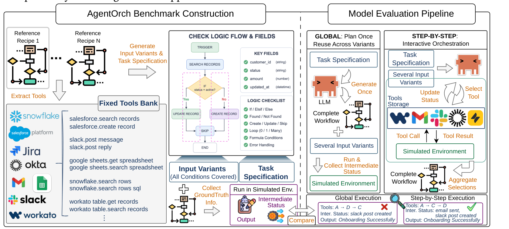

<div align="center">

# AgentOrch

### How Close Can Global Orchestration Come to Step-by-Step Interaction?

Zijie Liu¹, Qi Yang Huang², Jinhao Duan¹, Yueh Che Lee², Thomas A. Joseph²,<br>
Zayne Turner², Adam Seligman², Tianlong Chen¹, Zhaozhuo Xu²

¹ University of North Carolina at Chapel Hill · ² Workato

[Benchmark data](https://huggingface.co/datasets/JesseLiu/agentorch-benchmark) ·
[Training data](https://huggingface.co/datasets/JesseLiu/agentorch-training) ·
[Models](#models) · [Results](#results) · [Quick start](#quick-start) · [Citation](#citation)

</div>

**AgentOrch evaluates whether an LLM can write an entire executable workflow
up front, and how that compares with choosing tools one step at a time.**
Both approaches solve the same enterprise tasks with the same tools,
deterministic connector simulator, and execution-based scorer.

The benchmark contains **650 standard operating procedures (SOPs), 3,220
runtime variants, and a 64-tool interface**. A separate **3,000-recipe
training set**, disjoint by recipe ID, supports supervised fine-tuning (SFT)
and reinforcement learning (GRPO). This repository provides the evaluator,
simulator, training code, and published results; the full datasets and
**10 merged SFT / RL checkpoints** are available on Hugging Face.



## What AgentOrch measures

An SOP specifies the business task. Runtime variants change the concrete
inputs and connector state under which that task must succeed. Evaluation
checks the executed calls, their effects on the environment, and the final
response.

| Protocol | How the model solves the task | Evaluator mode |
| --- | --- | --- |
| **Global** | Generates one complete workflow before seeing concrete runtime inputs; the workflow is reused across the SOP's variants. | `plan_execute` |
| **Step-by-Step** | Chooses one tool call at a time, observing the input and intermediate execution results. | `react` |
| **Local** | Builds a workflow incrementally with editor and validation feedback, without executing it during construction. | `incremental_workflow` |
| **Replan** | Revises a Global workflow using execution feedback, then runs the revised workflow without further LLM calls. | `replan` |

The primary comparison is **Global versus Step-by-Step**. Local, Replan, SFT,
and GRPO examine ways to improve global workflow orchestration. See the
[pipeline](benchmark/doc/pipeline.md) and [worked case](benchmark/doc/case.md)
for the execution and scoring details.

## Results

- **Step-by-Step leads across all 31 models in the main comparison.** The
  Orchestration Accuracy gap is 40.67 percentage points for GPT-3.5 Turbo
  and 8.53 points for Claude Opus 5 Thinking.
- **Global amortizes planning across runtime variants.** One generated
  workflow serves multiple executions. The [cost table](benchmark/results/COST.csv)
  records model calls, completion tokens, and the coverage of token counters.
- **Complete-workflow training improves Global accuracy.** Across five model
  families, the better of the reported SFT and SFT + RL checkpoints improves
  over the base model by 12.18 percentage points on average.

### Global versus Step-by-Step

Orchestration Accuracy (%) on all 3,220 variants. For each variant, this is
`0.5 × execution-trace accuracy + 0.5 × side-effect accuracy`. Failed
generations and executions remain in the denominator at zero. Gap is
Step-by-Step minus Global, in percentage points.

| Model | Global | Step-by-Step | Gap |
| --- | ---: | ---: | ---: |
| Claude Opus 5 Thinking | 59.88 | 68.41 | 8.53 |
| GPT-5.6 Sol Thinking | 51.76 | 66.88 | 15.12 |
| Claude Opus 5 | 46.44 | 63.52 | 17.08 |
| Qwen 3.8 27B FP8 | 28.57 | 53.31 | 24.74 |
| GPT-4o | 28.09 | 50.12 | 22.03 |
| DeepSeek V4 Flash | 27.01 | 58.99 | 31.98 |

<details>
<summary>All 31 models in the main comparison</summary>

| # | Model | Global | Step-by-Step | Gap |
|--:|---|--:|--:|--:|
| 1 | Claude Opus 5 Thinking | **59.88** | **68.41** | 8.53 |
| 2 | GPT-5.6 Sol Thinking | 51.76 | 66.88 | 15.12 |
| 3 | Claude Opus 5 | 46.44 | 63.52 | 17.08 |
| 4 | Qwen 3.8 27B FP8 | 28.57 | 53.31 | 24.74 |
| 5 | GPT-4o | 28.09 | 50.12 | 22.03 |
| 6 | DeepSeek V4 Flash | 27.01 | 58.99 | 31.98 |
| 7 | Qwen 2.5 32B | 16.18 | 45.64 | 29.46 |
| 8 | Mistral Small 3.1 24B | 14.15 | 44.71 | 30.56 |
| 9 | Qwen 3 4B | 13.75 | 41.84 | 28.09 |
| 10 | GLM-4.5 FP8 | 12.93 | 54.47 | 41.54 |
| 11 | GLM-4.5 Air FP8 | 12.28 | 48.59 | 36.31 |
| 12 | Llama 3.1 70B | 10.81 | 38.92 | 28.11 |
| 13 | Llama 3.3 70B | 10.45 | 42.98 | 32.53 |
| 14 | GPT-3.5 Turbo | 10.11 | 50.78 | 40.67 |
| 15 | Qwen 2.5 72B | 9.91 | 46.57 | 36.66 |
| 16 | Gemma 3 12B | 8.46 | 37.85 | 29.39 |
| 17 | Qwen 3 30B | 8.35 | 47.81 | 39.46 |
| 18 | Gemma 3 27B | 7.41 | 39.93 | 32.52 |
| 19 | Command R | 6.64 | 35.97 | 29.33 |
| 20 | Granite 3.1 8B | 6.52 | 34.19 | 27.67 |
| 21 | Granite 3.1 2B | 6.30 | 31.83 | 25.53 |
| 22 | Gemma 3 4B | 6.15 | 32.75 | 26.60 |
| 23 | Qwen 2.5 14B | 5.33 | 41.54 | 36.21 |
| 24 | Llama 3.1 8B | 4.45 | 34.82 | 30.37 |
| 25 | Qwen 2.5 7B | 2.63 | 30.50 | 27.87 |
| 26 | Mistral Nemo | 2.26 | 34.27 | 32.01 |
| 27 | Qwen 2.5 3B | 2.19 | 34.16 | 31.97 |
| 28 | Llama 3.2 3B | 2.07 | 35.50 | 33.43 |
| 29 | Qwen 2.5 1.5B | 1.66 | 31.41 | 29.75 |
| 30 | Qwen 2.5 0.5B | 0.13 | 36.46 | 36.33 |
| 31 | Llama 3.2 1B | 0.00 | 36.93 | 36.93 |

</details>

Full results, additional models and protocols, confidence intervals, and
error rates are in [benchmark/results/](benchmark/results/). The
[combined leaderboard](results/combined_leaderboard.md) brings base, SFT,
and RL runs together. [Metric definitions](benchmark/doc/metric.md) describe
the individual checks and aggregation.

### Training for Global orchestration

Global Orchestration Accuracy (%) for the checkpoints linked below.
Δ is the better of SFT and SFT + RL minus the base score; it is measured in
percentage points. Additional checkpoint sweeps are recorded in the
[training results](training/results/training.csv).

| Model | Base | SFT | SFT + RL | Δ |
| --- | ---: | ---: | ---: | ---: |
| Qwen3.8-27B | 28.57 | **41.96** | 41.14 | +13.39 |
| Qwen3-4B | 13.75 | 25.46 | **27.16** | +13.41 |
| Gemma-4-26B-A4B | 4.05 | 19.89 | **23.93** | +19.88 |
| Gemma-4-12B | 14.26 | 17.92 | **21.66** | +7.40 |
| Gemma-4-31B | 12.71 | **19.55** | 19.10 | +6.84 |

## Quick start

Use **Python 3.12**. Run one sample workflow on the deterministic connector
simulator with no model, GPU, credentials, or data download:

```bash
git clone https://github.com/jesseliu0913/AgentOrch.git
cd AgentOrch
python3.12 -m venv .venv
source .venv/bin/activate
python -m pip install jsonschema==4.26.0

PYTHONPATH=benchmark python -m verification.connector_runner \
  --backend simulated --recipe-id 64112882 --variant 0
```

The final JSON object should contain `"verifier_ok": true`.

## Datasets

| Dataset | Contents | Hugging Face |
| --- | --- | --- |
| **Benchmark** | 650 SOPs / 3,220 variants; prompts, reference workflows, and simulator fixtures | [agentorch-benchmark](https://huggingface.co/datasets/JesseLiu/agentorch-benchmark) |
| **Training** | 3,000 disjoint recipes; reference workflows and prepared SFT / GRPO sets | [agentorch-training](https://huggingface.co/datasets/JesseLiu/agentorch-training) |

**For evaluation or training in this repository**, download the pinned
archives into the paths expected by the code:

```bash
python -m pip install huggingface_hub
python scripts/download_data.py --only benchmark          # evaluation fixtures
python scripts/download_data.py --only training --prepared # training + prepared SFT / RL sets
```

Source archives total approximately 250 MB compressed. The downloader places
files in the paths expected by the evaluator. Dataset specifications are in
[scripts/data_release.json](scripts/data_release.json).

**For direct access to the model-visible prompts**, use Hugging Face Datasets:

```bash
python -m pip install datasets
```

```python
from datasets import load_dataset

prompts = load_dataset(
    "JesseLiu/agentorch-benchmark",
    "global",
    split="train",
)
print(prompts[0]["task"])
```

The benchmark configs are `global` (650 rows), `local` (650), `react` (3,220),
and `replan` (3,220). The Hub's `train` split name is a storage convention;
these are **benchmark evaluation prompts**. The training dataset provides
`sft_messages_v1`, `sft_v1_80k`, `rl_verl_v1`, `rl_trl_v1`, and
`rl_trl_v1_31b`. Configs, fields, and subset sizes are described in the dataset
cards.

## Models

All ten checkpoints below are public, merged weights with model configuration
and tokenizer files. Bold links identify the better of SFT and SFT + RL for
each family in the training table above.

| Base model | SFT | RL |
|---|---|---|
| Qwen3.8-27B | [**agentorch-sft-27b-80k-3ep**](https://huggingface.co/JesseLiu/agentorch-sft-27b-80k-3ep) | [agentorch-rl-27b-3ep-step124](https://huggingface.co/JesseLiu/agentorch-rl-27b-3ep-step124) |
| Qwen3-4B | [agentorch-sft-4b-v1-2ep](https://huggingface.co/JesseLiu/agentorch-sft-4b-v1-2ep) | [**agentorch-rl-4b-v1-step60**](https://huggingface.co/JesseLiu/agentorch-rl-4b-v1-step60) |
| Gemma-4-26B-A4B | [agentorch-sft-gemma26b-v1-2ep](https://huggingface.co/JesseLiu/agentorch-sft-gemma26b-v1-2ep) | [**agentorch-rl-gemma26b-step680**](https://huggingface.co/JesseLiu/agentorch-rl-gemma26b-step680) |
| Gemma-4-12B | [agentorch-sft-gemma12b-v1-2ep](https://huggingface.co/JesseLiu/agentorch-sft-gemma12b-v1-2ep) | [**agentorch-rl-gemma12b-final**](https://huggingface.co/JesseLiu/agentorch-rl-gemma12b-final) |
| Gemma-4-31B | [**agentorch-sft-gemma31b-v1-1ep**](https://huggingface.co/JesseLiu/agentorch-sft-gemma31b-v1-1ep) | [agentorch-rl-gemma31b-final](https://huggingface.co/JesseLiu/agentorch-rl-gemma31b-final) |

The Qwen3.8-27B SFT checkpoint is **step 474 of a five-epoch cosine schedule**,
corresponding to three passes through the data. Training a separate three-epoch
schedule does not reproduce that checkpoint. Model cards record base revisions,
training settings, evaluation runs, and scores.

## Evaluate your model

### Any model behind a Chat Completions endpoint

Run the evaluator on a CPU machine while your model runs on its own server.
This route needs no local PyTorch, CUDA, or vLLM installation:

```bash
python3.12 -m venv .venv-eval
source .venv-eval/bin/activate
python -m pip install -r benchmark/requirements-api.txt
python scripts/download_data.py --only benchmark

export LOCAL_LLM_BASE_URL=http://localhost:8000/v1
export LOCAL_LLM_API_KEY=your-server-key  # omit for an unauthenticated server

PYTHONPATH=benchmark python -m evaluation.full_eval \
  --run-name my-model --backend simulated \
  --model compat:my-served-model \
  --modes plan_execute,react --ids 64112882 --variants all
```

Replace the endpoint and `my-served-model` with your server's values. The
`compat:` prefix selects your endpoint even when the served model name starts
with `gpt-` or `claude-`; the prefix is removed before sending the request.
The server must accept `POST /v1/chat/completions` and return the model's JSON
plan or tool call as text in `choices[0].message.content`. AgentOrch supplies
the prompts and executes the tools.

This first run evaluates all five variants of the included SOP. For the full
**650-SOP / 3,220-variant** benchmark, remove `--ids 64112882`. Add `--resume`
with the same run name, model, and protocol to continue an interrupted run.
Use a new run name when changing the model or generation settings.

### Hugging Face checkpoints loaded locally

Install the local GPU stack in a separate Python 3.12 environment:

```bash
python -m pip install -r benchmark/requirements.txt
python scripts/download_data.py --only benchmark
export HF_LOCAL_ENGINE=vllm

PYTHONPATH=benchmark python -m evaluation.full_eval \
  --run-name local-model --backend simulated \
  --model hf:JesseLiu/agentorch-sft-4b-v1-2ep \
  --modes plan_execute,react --ids 64112882 --variants all
```

Use `hf:<org>/<model>` for a Hub checkpoint or `hf:/absolute/checkpoint/path`
for your own weights. Set `VLLM_TENSOR_PARALLEL` for models that span multiple
GPUs. The default local protocol reserves 122,880 input tokens plus up to
8,192 output tokens in a 131,072-token context; the Global output cap is
4,096. [The evaluation guide](benchmark/README.md#the-canonical-evaluator)
provides the generation settings and context options.

### Provider APIs and results

Provider model IDs are also supported: set `OPENAI_API_MODE=direct` and
`OPENAI_API_KEY` for OpenAI, the `AZURE_OPENAI_*` settings for Azure, or
`ANTHROPIC_API_KEY` for Claude. Credentials can go in `.env` using
[.env.example](.env.example). Run the same command with `--model <provider-model-id>`.

Each protocol writes `results.jsonl`, `trajectories.jsonl`, and
`leaderboard.json` under:

```text
benchmark/outputs/full_eval/<run-name>/<model>/<mode>/
```

For example, `compat:my-served-model` produces
`my-model/compat:my-served-model/plan_execute/leaderboard.json` beneath
`benchmark/outputs/full_eval/`. Read `n`, `orchestration_accuracy`,
`final_accuracy`, and `error_rate` from that JSON. A complete single-run
benchmark has `n = 3220` for each protocol. Failed generations, context-limit
errors, and failed executions stay in the denominator. Additional protocols,
provider examples, and model integration are in the [evaluation guide](benchmark/README.md#run-an-evaluation).

## Train a model

Run LoRA SFT with the prepared training set in a separate environment. The
following Qwen3.8-27B example uses eight GPUs:

```bash
conda create -n agentorch-train python=3.12 -y
conda activate agentorch-train
python -m pip install -r training/requirements-sft.txt
python scripts/download_data.py --only training --prepared

WANDB_MODE=offline torchrun --nproc-per-node 8 training/src/sft/train_sft_local.py \
  --model Qwen/Qwen3.8-27B \
  --data training/data/sft_v1_80k/train.jsonl \
  --epochs 5 --max-len 81920 --save-every-steps 158 \
  --lora-r 16 --lora-alpha 32 --lr 1e-4 --seed 0 \
  --run-name sft-27b-80k-5ep \
  --output training/output/checkpoints/sft-27b-80k-5ep-lora
```

Adapters are saved under `training/output/checkpoints/`. The reported 27B SFT
checkpoint is `step-474`. For checkpoint merging, GRPO with verl or TRL, and
Slurm launchers, see the [training guide](training/README.md).

## Project structure

| Directory | Contents |
| --- | --- |
| [benchmark/](benchmark/README.md) | Evaluation harness, connector simulator, metrics, and experiment drivers |
| [training/](training/README.md) | Data preparation, SFT / GRPO, checkpoint merging, and transfer evaluation |
| [results/](results/combined_leaderboard.md) | Combined base / SFT / RL leaderboard |
| [benchmark/reproduction/](benchmark/reproduction/README.md) | Offline scoring and reproduction scripts |
| [scripts/](scripts/) | Dataset downloader and leaderboard builder |

## Citation

```bibtex
@misc{liu2026agentorch,
  title  = {AgentOrch: How Close Can Global Orchestration Come to Step-by-Step Interaction?},
  author = {Liu, Zijie and Huang, Qi Yang and Duan, Jinhao and Lee, Yueh Che and Joseph, Thomas A.
            and Turner, Zayne and Seligman, Adam and Chen, Tianlong and Xu, Zhaozhuo},
  year   = {2026}
}
```

Contact: Zijie Liu ([jesseliu@cs.unc.edu](mailto:jesseliu@cs.unc.edu)).
