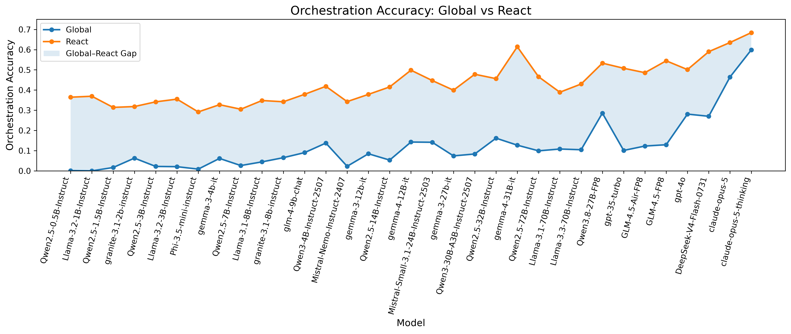

# AgentOrch Benchmark

AgentOrch measures whether a language model can **orchestrate a business
workflow over real connector tools**: 650 automation recipes (Slack, Jira,
Salesforce, Google Sheets, Google Drive, Snowflake and the Workato platform
tools: data tables, API endpoints, recipe functions, pub/sub, ...) with
3,220 hidden runtime variants, executed on a deterministic connector simulator
and scored against a frozen reference execution. Every model is evaluated under
four mutually exclusive decision protocols on the same tasks:

| Mode | Evaluator name (`--modes`) | What the model sees | What the model emits |
| --- | --- | --- | --- |
| **Global View** | `plan_execute` | one recipe-level task specification and a 64-card tool catalog, no runtime data | one complete symbolic `WorkflowPlan`, frozen and executed on every hidden variant |
| **Local View** | `incremental_workflow` | the same specification, built up through an append-only plan editor | one plan, assembled one edit at a time |
| **ReAct** | `react` | the public prompt for one concrete variant plus every tool observation so far | one JSON tool call per turn |
| **Replan** | `replan` | the ReAct boundary plus permission to revise its plan after simulator feedback | a plan, then revisions |

One information-control ablation sits between Global View and ReAct:
**Global+Input** (`global_input`) gives the Global View specification plus the
concrete public runtime input of one variant, with no execution feedback.
Protocol and fairness rules: [`doc/global_input.md`](doc/global_input.md).

## Where are the benchmark code, simulator, and connectors?

They are included in this directory. The runtime is vendored under
`verification/backends/` rather than in a top-level folder named `simulator`.
That layout lets the deterministic simulator and the optional live connectors
share exactly the same recipe engine, tool schemas, and scorer.

| Component | Source path |
| --- | --- |
| Canonical full benchmark entry point | [`evaluation/full_eval.py`](evaluation/full_eval.py) |
| Backend selector | [`verification/backend.py`](verification/backend.py) |
| One-recipe seed / execute / verify CLI | [`verification/connector_runner.py`](verification/connector_runner.py) |
| Deterministic connector state machines | [`verification/backends/simulated/src/benchmark/simulated_connectors.py`](verification/backends/simulated/src/benchmark/simulated_connectors.py) |
| Simulated tool registration and handlers | [`verification/backends/simulated/src/benchmark/simulated_tools.py`](verification/backends/simulated/src/benchmark/simulated_tools.py) |
| Shared recipe executor and expression runtime | [`verification/backends/shared/src/benchmark/raw_executor.py`](verification/backends/shared/src/benchmark/raw_executor.py) |
| Tool registry and schemas | [`verification/backends/shared/src/benchmark/tools.py`](verification/backends/shared/src/benchmark/tools.py) |
| 650 executable recipe definitions | [`verification/backends/shared/src/benchmark/recipes/`](verification/backends/shared/src/benchmark/recipes/) |
| Frozen verifier and metric aggregation | [`verification/backends/shared/src/benchmark/verifier.py`](verification/backends/shared/src/benchmark/verifier.py), [`verification/backends/shared/src/metrics/`](verification/backends/shared/src/metrics/) |
| Per-variant simulator seeds | [`verification/seeds/`](verification/seeds/) |
| Optional credentialed connector overlay | [`verification/backends/real/src/benchmark/`](verification/backends/real/src/benchmark/) |
| Model-visible benchmark inputs | [`input/`](input/) |
| Evaluator-only expected traces and states | [`groundtruth/`](groundtruth/) and [`verification/groundtruth/`](verification/groundtruth/) |

The execution path is:

```text
evaluation/full_eval.py
  -> verification.backend.activate("simulated")
  -> canonical task/run_eval.py and the selected model client
  -> simulated_tools.py -> simulated_connectors.py
  -> mutable seeded connector state
  -> verifier.py -> metrics/aggregate.py
  -> outputs/full_eval/<run>/<model>/<mode>/
```

The two backend overlays intentionally expose the same Python package name,
`benchmark`. `verification.backend.activate()` puts either `simulated/src` or
`real/src` first on `sys.path`, followed by `shared/src`, and refuses to mix
both backends in one process. Consequently, do not import the internal
`benchmark` package directly before activating a backend; use
`evaluation.full_eval` or `verification.connector_runner`.

From the release root (the directory containing `benchmark/`), the shortest
simulator check is:

```bash
PYTHONPATH=benchmark python -m verification.connector_runner \
  --backend simulated --recipe-id 64112882 --variant 0
```

It seeds the connector state, executes the recipe, verifies the final state,
and should print `"ok": true` and `"verifier_ok": true`. To exercise the
same full evaluator used for reported model scores, without downloading a
model, run:

```bash
PYTHONPATH=benchmark python -m evaluation.full_eval \
  --run-name install-check --backend simulated --state-namespace install-check \
  --model scripted-selftest --modes plan_execute,react \
  --variants all --ids 64112882 --scripted-selftest
```

This second command is a harness integrity test, not a model result. The
real-model command is in [Run an evaluation](#run-an-evaluation).

The headline finding: models plan far worse than they act. Every model scores
higher in ReAct than in Global View, and the gap narrows only for the strongest
frontier models.



## Results

Orchestration accuracy (0.5 x execution-trace accuracy + 0.5 x side-effect
accuracy, all 3,220 variants, failed runs scored zero, greedy decoding) for the
models evaluated in both Global View and ReAct. Full rows with final accuracy,
side-effect accuracy, error rates and run provenance are in
[`results/results.csv`](results/results.csv). Fine-tuned checkpoints live in
the training project ([`../training/results/training.csv`](../training/results/training.csv));
the combined base / SFT / RL view is [`../results/combined_leaderboard.md`](../results/combined_leaderboard.md).

| Model | Tier | Global View | ReAct | Local View | Replan |
|---|---|---:|---:|---:|---:|
| claude-opus-5-thinking | large | 0.599 | 0.684 | – | – |
| gpt-5.6-sol-thinking | large | 0.518 | 0.669 | – | – |
| claude-opus-5 | large | 0.464 | 0.635 | – | – |
| Qwen3.8-27B-FP8-thinking | large | 0.330 | 0.631 | 0.415 | 0.330 |
| GLM-5.2-FP8-thinking | large | 0.177 | 0.627 | – | – |
| GLM-5.2-FP8 | large | 0.192 | 0.622 | – | – |
| gemma-4-31B-it | large | 0.127 | 0.614 | – | – |
| DeepSeek-V4-Flash-0731 | large | 0.270 | 0.590 | – | – |
| DeepSeek-V4-Flash-0731-thinking | large | 0.171 | 0.589 | – | – |
| Muse-Glimmer-30B-thinking | large | 0.141 | 0.548 | – | – |
| GLM-4.5-FP8-thinking | large | 0.201 | 0.547 | – | – |
| GLM-4.5-FP8 | large | 0.129 | 0.545 | – | – |
| Qwen3.8-27B-FP8 | large | 0.286 | 0.533 | 0.328 | 0.294 |
| gemma-4-26B-A4B-it | medium | 0.041 | 0.521 | 0.064 | 0.044 |
| Qwen3-30B-A3B-Thinking-2507 | large | 0.147 | 0.521 | – | – |
| gpt-35-turbo | large | 0.101 | 0.508 | – | – |
| gpt-4o | large | 0.281 | 0.501 | – | – |
| gemma-4-12B-it | medium | 0.143 | 0.498 | 0.107 | 0.147 |
| GLM-4.5-Air-FP8-thinking | large | 0.107 | 0.495 | – | – |
| GLM-4.5-Air-FP8 | large | 0.123 | 0.486 | 0.190 | 0.084 |
| Qwen3-30B-A3B-Instruct-2507 | large | 0.084 | 0.478 | 0.085 | 0.085 |
| Qwen3-4B-Thinking-2507 | small | 0.102 | 0.473 | – | – |
| Qwen2.5-72B-Instruct | large | 0.099 | 0.466 | – | 0.103 |
| Qwen2.5-32B-Instruct | large | 0.162 | 0.456 | – | – |
| Mistral-Small-3.1-24B-Instruct-2503 | large | 0.141 | 0.447 | 0.273 | 0.145 |
| Llama-3.3-70B-Instruct | large | 0.104 | 0.430 | 0.349 | 0.105 |
| Qwen3-4B-Instruct-2507 | small | 0.138 | 0.418 | 0.069 | 0.138 |
| Qwen2.5-14B-Instruct | medium | 0.053 | 0.415 | – | – |
| gemma-3-27b-it | large | 0.074 | 0.399 | 0.126 | 0.074 |
| Llama-3.1-70B-Instruct | large | 0.108 | 0.389 | – | – |
| glm-4-9b-chat | medium | 0.090 | 0.379 | 0.044 | 0.091 |
| gemma-3-12b-it | medium | 0.085 | 0.379 | 0.165 | 0.085 |
| Llama-3.2-1B-Instruct | small | 0.000 | 0.369 | – | – |
| Qwen2.5-0.5B-Instruct | small | 0.001 | 0.365 | – | – |
| c4ai-command-r-08-2024 | large | 0.066 | 0.360 | – | 0.069 |
| Llama-3.2-3B-Instruct | small | 0.021 | 0.355 | – | – |
| Llama-3.1-8B-Instruct | medium | 0.044 | 0.348 | – | – |
| Mistral-Nemo-Instruct-2407 | medium | 0.023 | 0.343 | 0.004 | 0.023 |
| granite-3.1-8b-instruct | medium | 0.065 | 0.342 | – | – |
| Qwen2.5-3B-Instruct | small | 0.022 | 0.342 | 0.228 | 0.022 |
| gemma-3-4b-it | medium | 0.061 | 0.328 | – | – |
| granite-3.1-2b-instruct | small | 0.063 | 0.318 | – | – |
| Qwen2.5-1.5B-Instruct | small | 0.017 | 0.314 | – | – |
| Qwen2.5-7B-Instruct | medium | 0.026 | 0.305 | – | – |
| Phi-3.5-mini-instruct | small | 0.009 | 0.292 | – | – |

Tiers: small <= 4B parameters, medium 4B-15B, large > 15B or frontier API.
`-thinking` rows are test-time-reasoning ablations reported separately from the
canonical direct-JSON protocol. Per-mode decoding caps and every pinned
checkpoint revision are in
[`evaluation/global_react_models.json`](evaluation/global_react_models.json)
and [`doc/exp.md`](doc/exp.md).

Result tables in [`results/`](results/):

| File | Contents |
| --- | --- |
| `results.csv` | frozen published snapshot, one row per model x mode |
| `leaderboards/<model>__<mode>.json` | the archived `leaderboard.json` aggregate behind each row (metrics with bootstrap CIs) |
| `replan_iter.csv` | iterative self-revision ("self-evolution") curves per model and round |
| `local_view.csv` | frozen Local View ablation (`incremental_workflow`) |
| `global_input.csv` | frozen Global+Input ablation (`global_input`) |
| `COST.csv` | token and call counts per lane |
| `uncertainty.md` | temperature sweep: how much of each score survives sampling |
| `validation_checks/` | archived simulator-replay and complexity analyses |

These are paper artifacts, not inputs to the evaluator. Community runs always
write their own per-lane `leaderboard.json`; users may organize multiple runs
however they prefer. Paper-specific CSV/Markdown table builders are
intentionally excluded from this release.

## Layout

All commands in this document run from the **release root** (the directory
that contains `benchmark/`) with `PYTHONPATH=benchmark`. The source packages
resolve `input/`, `groundtruth/`, `verification/` and `outputs/` relative to
their own location, so the folders below must stay siblings.

A plain clone contains only the sample recipe `64112882` under `input/`,
`groundtruth/` and `verification/{dataset,evaluation_support,groundtruth,seeds}/`.
Fetch all 650 recipes and 3,220 variants before a full evaluation:

```bash
python scripts/download_data.py --only benchmark
```

```text
benchmark/
  input/                      model-visible task prompts (public)
    manifest.json             650 recipes, 3,220 variant ids
    recipes/<recipe_id>/
      GLOBAL_VIEW_{system,user}.txt   LOCAL_VIEW_{system,user}.txt
      REACT_system.txt  REACT_variant_XX_user.txt
      PUBLIC_PACKAGE.json     structured public planning package
  groundtruth/                per-variant reference trace, tool expectations,
    recipes/<id>/variant_XX.json   final state and terminal contract (evaluator only)
  evaluation/                 harness source
    full_eval.py              canonical entry point (all released numbers)
    global_react_models.json  roster: revisions, tiers, caps, canonical runs
  examples/smoke_adapter/     optional two-recipe adapter example; not leaderboard-compatible
  experiments/               optional iterative-revision and ablation drivers
  reproduction/
    offline/                  re-aggregate or re-score a run you already have
    cluster/                  optional Slurm launchers and pinned campaign settings
  verification/               runtime source + evaluator-private state
    backends/shared/src       vendored recipe runtime + canonical scorer
    backends/simulated/src    deterministic connector simulator (all published numbers)
    backends/real/src         live connector overlay (credentialed sandboxes only)
    seeds/                    private simulator state per variant
    dataset/, groundtruth/, evaluation_support/   replay fixtures, reference executions
    smoke/                    dependency-light two-recipe runtime for adapter tests
    backend.py                fail-closed backend selector
    connector_runner.py       one-variant seed / run / verify CLI
  results/                    published tables and per-lane leaderboards
  doc/                        metric definitions, pipeline, experiments, case study, change log
  figures/                    rendered paper figures
  outputs/                    run outputs (not committed)
  requirements.txt            environment lock (credentials: ../.env.example)
```

## Set up from scratch

### 1. Prerequisites

- Linux x86_64 and Python 3.12. The scorer and simulator are pure Python.
- A CUDA GPU only if you evaluate open-weight checkpoints locally. The
  published runs used one to four H200 80 GB GPUs per model with vLLM.
- Slurm only for the optional launchers in `reproduction/cluster/`. Everything can be run
  directly with `python -m ...`.
- Provider credentials only for API models (Azure OpenAI or OpenAI,
  Anthropic) and gated Hugging Face checkpoints.

### 2. Create the environment

```bash
conda create -n benchmark python=3.12 -y
conda activate benchmark
python -m pip install -r benchmark/requirements-api.txt
```

This CPU environment runs the canonical evaluator against HTTP endpoints
(self-hosted models, OpenAI, Azure, or Anthropic), the simulator, and the
scorer. It does not need a GPU or provider SDK.

For checkpoints loaded inside the evaluator, use a separate environment and
install `python -m pip install -r benchmark/requirements.txt`. That file pins
the local GPU and analysis stack used for the published runs. A compatible
GPU and enough memory for the model and long prompts are required.

vLLM builds a few kernels at job start and needs a CUDA toolkit. The launchers
take it from `AGENTORCH_CUDA_HOME` (step 4); leave it empty if `nvcc` is
already on your PATH.

### 3. Credentials

```bash
cp .env.example .env         # release root, gitignored
```

Fill in only what you use: `HF_TOKEN` for gated checkpoints,
`OPENAI_API_KEY` plus either `OPENAI_API_MODE=direct` or the
`AZURE_OPENAI_*` block for GPT models, `ANTHROPIC_API_KEY` for Claude models.
The simulated connector backend needs no connector credentials. Never commit
`.env`. `evaluation.full_eval` loads it at start-up (`$AGENTORCH_ENV_FILE`,
then the release-root `.env`, then `benchmark/.env`; variables already in the
shell win) and never prints it. The Slurm launchers source the same file
themselves. Exporting it into the shell also works:

```bash
set -a; source .env; set +a
```

### 4. Site settings for the Slurm launchers

```bash
cp benchmark/reproduction/cluster/env.sh.example benchmark/reproduction/cluster/env.sh
$EDITOR benchmark/reproduction/cluster/env.sh
```

`env.sh` is the single place for machine-specific paths: the interpreter,
the Hugging Face cache, the credential files, an optional CUDA toolkit and an
optional Azure endpoint. Every `.sbatch` sources it after changing to the
release root, and jobs are submitted with `--export=NIL`, so nothing else
from your shell leaks into a run. Skip this step if you never use Slurm.

### 5. Download the pinned checkpoints (local models only)

```bash
bash benchmark/reproduction/cluster/download_scale_extension_models.sh
```

Jobs run with `HF_HUB_OFFLINE=1`, so every checkpoint must be present at the
revision recorded in `evaluation/global_react_models.json` before submission.
Gated repositories require the `HF_TOKEN` account to have accepted the model
license first; the script lists what it could not fetch.

### 6. Verify the installation

Score one recipe with the dependency-free example adapter (no model, no GPU,
about a second):

```bash
PYTHONPATH=benchmark python -m examples.smoke_adapter.eval \
  --mode global --adapter examples.smoke_adapter.example_adapter:build \
  --model-id smoke-test --run-name smoke --recipe-id 64112882 --limit 1
```

The last line is a JSON summary with `"n": 1` and the five metrics; the
record lands in `benchmark/outputs/smoke/smoke-test/global.jsonl`.
Use `--mode react` for the interactive path. Then run one seed / execute /
verify cycle on the vendored connector runtime:

```bash
PYTHONPATH=benchmark python -m verification.connector_runner \
  --backend simulated --recipe-id 64112882 --variant 0
```

It ends with `"verifier_ok": true`. Finally, the vendored evaluator tests:

```bash
cd benchmark
PYTHONPATH=verification/backends/simulated/src:verification/backends/shared/src \
  python -m pytest verification/backends/shared/src/tests -q
```

## Run an evaluation

### Evaluate a self-hosted or third-party model

Use the CPU environment above and start your model server separately. It
must implement the Chat Completions messages API. For vLLM, SGLang, or another
compatible server, use its API root including `/v1` and its served model name:

```bash
export LOCAL_LLM_BASE_URL=http://localhost:8000/v1
export LOCAL_LLM_API_KEY=your-server-key  # optional for servers without authentication

# One SOP, all five variants; also works before downloading the full dataset.
PYTHONPATH=benchmark python -m evaluation.full_eval \
  --run-name my-model --backend simulated \
  --model compat:my-served-model --ids 64112882 \
  --modes plan_execute,react --variants all

# Full benchmark; retain the same run/model/settings to continue the sample run.
PYTHONPATH=benchmark python -m evaluation.full_eval \
  --run-name my-model --backend simulated \
  --model compat:my-served-model \
  --modes plan_execute,react --variants all --resume
```

The `compat:` prefix is stripped from the request's `model` field. It always
selects `LOCAL_LLM_BASE_URL`, including when the served name starts with
`gpt-`, `claude-`, or contains a Hub namespace. Without the explicit prefix,
provider-looking model IDs select their provider client.

The harness sends system/user messages, `temperature: 0`, and a 4,096-token
completion cap. The endpoint returns text in `choices[0].message.content`:
a JSON workflow (`{"plan": [...]}`) for Global, or one JSON tool call
(`{"tool": "...", "args": {...}}`) per ReAct turn. The prompt specifies the
complete format. Tool execution belongs to the benchmark; the server does
not execute business connectors. Configure the server's context window for
the task lengths; the published local protocol uses 131,072 tokens. Server
context errors are recorded as failed rows, without removing those variants
from the aggregate.

### Evaluate a provider API

Install `requirements-api.txt`, fetch the benchmark, and set credentials in
`.env` or the environment. For example:

```bash
export OPENAI_API_MODE=direct
export OPENAI_API_KEY=your-provider-key
PYTHONPATH=benchmark python -m evaluation.full_eval \
  --run-name my-openai-run --model gpt-4o \
  --ids 64112882 --modes plan_execute,react --variants all
```

For Azure, set `OPENAI_API_MODE=azure`, `AZURE_OPENAI_ENDPOINT`,
`AZURE_OPENAI_API_KEY`, `AZURE_OPENAI_DEPLOYMENT`, and the API version.
For Claude, set `ANTHROPIC_API_KEY` and pass its model ID to `--model`.
`OPENAI_MAX_TOKENS`, `OPENAI_REASONING_EFFORT`, `ANTHROPIC_MAX_TOKENS`, and
`ANTHROPIC_THINKING` configure provider-specific generation. Reasoning effort
is model-dependent; GPT-3/4 chat requests omit that parameter. See the model
roster and campaign settings for the configurations used in the paper.

### The canonical evaluator

`evaluation.full_eval` is the entry point behind every released number. It
activates one vendored connector backend, points the canonical scorer at the
evaluator-private fixtures, and runs the selected modes over every recipe and
variant:

`PYTHONPATH=benchmark python -m evaluation.full_eval --help` lists the
model, recipe selection, protocol, and resume options. Commands run from the
release root. Before the model is loaded or called, the evaluator checks that
the selected recipe packages and per-variant simulator/reference files exist.
Download the full fixtures with `python scripts/download_data.py --only benchmark`;
a fresh clone can run `--ids 64112882` immediately.

```bash
PYTHONPATH=benchmark python -m evaluation.full_eval \
  --run-name my-first-run \
  --backend simulated \
  --model hf:Qwen/Qwen3-4B-Instruct-2507 \
  --modes plan_execute,react \
  --variants all --resume
```

| Option | Meaning |
| --- | --- |
| `--run-name` | output folder under `benchmark/outputs/full_eval/` |
| `--backend` | `simulated` (deterministic, default) or `real` (credentialed live connectors) |
| `--model` | `compat:<served-model>` for your Chat Completions endpoint; `hf:<org>/<name>` or `hf:/absolute/path` for a local checkpoint; `gpt-*`/`o*` for OpenAI or Azure; `claude-*` for Anthropic |
| `--modes` | comma list of `plan_execute`, `global_input`, `incremental_workflow`, `react`, `replan` |
| `--variants` | `all` for the full 3,220-row protocol |
| `--limit N` / `--ids ...` | restrict to the first N recipes or an explicit id list (smoke tests, shards) |
| `--resume` | skip variants already in `results.jsonl`; safe to re-submit a killed job |
| `--state-namespace` | isolated mutable simulator state; give concurrent jobs different names |
| `--max-replans`, `--replan-protocol` | replan mode only |

Local checkpoints load through vLLM when `HF_LOCAL_ENGINE=vllm` (the
published protocol) and through plain transformers otherwise. The decoding
protocol is set by environment variables; the values used for every published
row are (also the default local token budgets):

```bash
export HF_LOCAL_ENGINE=vllm
export HF_MAX_NEW_TOKENS=4096            # one-shot Global View plan (all models)
export HF_REACT_MAX_NEW_TOKENS=8192      # ReAct turn hard cap, local models
export HF_REACT_SOFT_MAX_NEW_TOKENS=1024 # ReAct turn soft cap (early JSON stop)
export HF_MODEL_CONTEXT_TOKENS=131072
export HF_MAX_INPUT_TOKENS=122880
export HF_MODEL_REVISION="<pinned commit from evaluation/global_react_models.json>"
export HF_HUB_OFFLINE=1 TRANSFORMERS_OFFLINE=1
```

API models use a 4,096-token visible-output cap per request and greedy
decoding; Claude runs set `ANTHROPIC_THINKING=disabled` so hidden reasoning
does not consume the cap. The exact per-lane settings are the `.sbatch` files
themselves, which is why they are part of the release.

Outputs for one run:

```text
benchmark/outputs/full_eval/<run-name>/<model>/<mode>/
  results.jsonl        one scored record per recipe-variant (plan, verdicts, scores)
  trajectories.jsonl   the full simulated execution per variant
  leaderboard.json     the aggregate: three primary metrics with bootstrap CIs
  artifacts/           frozen-plan artifacts (planning modes)
```

### Read results and resume a run

Each model/protocol directory contains `results.jsonl`, `trajectories.jsonl`,
and `leaderboard.json`. For the endpoint example above:

```bash
python - <<'PYRESULT'
import json
from pathlib import Path
root = Path("benchmark/outputs/full_eval/my-model/compat:my-served-model")
for mode in ("plan_execute", "react"):
    board = json.loads((root / mode / "leaderboard.json").read_text())
    print(mode, {k: board[k] for k in
                 ("n", "orchestration_accuracy", "final_accuracy", "error_rate")})
PYRESULT
```

A full single-run evaluation has `n = 3220` **per protocol**. The sample SOP
has `n = 5`. Scores are proportions in `[0, 1]`; multiply by 100 for percent.
Failed rows count as zero and remain in `n`, so inspect `error_rate` and the
row-level `status` / `error` fields when diagnosing a run.

Use `--resume` with the same run name, model, modes, and generation settings.
Completed task rows are not sent to the model again; cached Global plans are
reused. Use a new run name when changing a checkpoint, endpoint, prompt, or
generation settings. A run without `--resume` rewrites its result files.

### Slurm launchers

`reproduction/cluster/` contains one protocol script per campaign and one launcher per
model. Launchers `cd` to the release root and submit their model's array
index of the shared protocol script, so they work from any directory:

```bash
benchmark/reproduction/cluster/large_model/gpt-4o.sh                # canonical lane
benchmark/reproduction/cluster/large_model/gpt-4o.sh my-run 5       # 5 recipes only
benchmark/reproduction/cluster/small_model/Qwen3-4B-Instruct-2507.sh my-run "" react
```

Arguments are positional: `[run_name [recipe_limit [modes]]]`. Each protocol
script pins the checkpoint revisions, decoding caps, concurrency and GPU shape
for its group:

| Protocol script | Campaign |
| --- | --- |
| `run_instruct_scale_comparison.sbatch` | original eight open checkpoints, 0.5B-32B |
| `run_scale_extension.sbatch`, `run_scale_extension_70b.sbatch` | fifteen single-GPU checkpoints; three 70B-class on two GPUs |
| `run_scale_frontier.sbatch` | large open-weight models (GLM, DeepSeek, Qwen3.8, gemma-4) |
| `run_api_model_comparison.sbatch` | gpt-4o, gpt-35-turbo, claude-opus-5, extensions |
| `run_thinking_local.sbatch`, `run_thinking_pairs.sbatch`, `run_opus_thinking_ablation.sbatch` | test-time-reasoning ablations |
| `run_local_view.sbatch` | Local View (`incremental_workflow`) |
| `submit_global_input.sh` | Global+Input (`global_input`) through each model's own launcher; `global_input_selfcheck.py` is the CPU end-to-end check |
| `run_replan_expanded.sbatch`, `run_replan_scale.sbatch` | Replan mode |
| `run_replan_iter_smoke.sbatch`, `run_replan_iter_heldout.sbatch` | iterative self-revision, seen and held-out variants |
| `run_temp_sweep.sbatch` + `submit_temp_sweep.sh` | temperature sweep behind `results/uncertainty.md` |
| `run_greedy_recheck.sbatch` | greedy re-runs used to audit the noise floor |

Slurm logs go to `benchmark/outputs/slurm_logs/`. Nodes to avoid are passed
on the `sbatch` command line (`--exclude=<node>`) or through
`AGENTORCH_SLURM_EXCLUDE` in `env.sh`, never inside the scripts.

### Bring your own model

Two routes, depending on how deep you want to integrate:

1. **Adapter on the smoke harness** (`examples.smoke_adapter.eval`). Implement three
   methods and point `--adapter module:factory` at a function that returns
   the object. `examples/smoke_adapter/example_adapter.py` is the minimal
   template and `examples/smoke_adapter/model_corpus.py` a Hugging Face example:
   - `propose_plan(task) -> list[dict]` for Global View (and
     `propose_incremental_plan` for Local View);
   - `start(task, mode=..., tool_specs=...)` and
     `act(observation) -> dict` for ReAct and Replan, returning
     `{"tool": name, "args": {...}}` per turn or `{"final_answer": ...}`.
   The smoke runtime covers recipes `64112882` and `69270259` only; it exists
   to validate protocols quickly, not to produce comparable numbers.
2. **Client in the canonical evaluator.** `build_client()` in
   `verification/backends/shared/src/task/llm_client.py` maps a model id to a
   client class. Any OpenAI-compatible server works without code changes:
   set `LOCAL_LLM_BASE_URL` and pass `compat:<served-model>` to `--model`.
   This explicit prefix avoids provider-name routing for your own server.

Whatever the route, the model only ever receives files from `input/` and the
public tool observations; `groundtruth/`, `verification/seeds/` and the
reference executions are never placed in a prompt. `--debug` on the smoke
adapter prints every handoff so you can confirm that yourself.

### Other experiment drivers

```bash
# Iterative self-revision: round 0 is the frozen Global View plan, each round
# shows the model its plan plus execution feedback and asks for a revision.
PYTHONPATH=benchmark python -m experiments.replan_iter \
  --run-name replan-iter --state-namespace ri --backend simulated \
  --model hf:Qwen/Qwen3.8-27B-FP8 --rounds 3 --resume

# Same, with feedback restricted to the first two variants of each recipe and
# scoring split into seen / held-out variants.
PYTHONPATH=benchmark python -m experiments.replan_iter_heldout \
  --run-name replan-heldout --state-namespace rh --backend simulated \
  --model hf:Qwen/Qwen3.8-27B-FP8 --rounds 3 --feedback-variants 2 --resume
```

## Scoring

Every recipe-variant receives three primary metrics in `[0, 1]` and two
diagnostics. Failed generations and executions stay in the denominator at
zero. Aggregation is a plain mean over the 3,220 rows with a cluster bootstrap
(by recipe, fixed seed) for the confidence intervals.

| Metric | Definition |
| --- | --- |
| execution-trace accuracy (diagnostic) | mean of five binary checks: tool selection, tool order, successful execution, required semantic arguments, control path |
| side-effect accuracy | required state-changing calls happened and the final backend state matches the reference |
| **orchestration accuracy** | 0.5 x execution-trace + 0.5 x side-effect |
| terminal-output accuracy (diagnostic) | the terminal response matches the reference contract |
| **final accuracy** | side-effect accuracy AND terminal-output accuracy |

[`doc/metric.md`](doc/metric.md) has the exact criteria and worked examples;
[`doc/pipeline.md`](doc/pipeline.md) walks through one evaluation row from
prompt to leaderboard; [`doc/case.md`](doc/case.md) reproduces one complete
instance, prompts and ground truth included.

### Reproduce the published numbers offline

None of these needs a model or a GPU. They operate on archived
`results.jsonl` files (see "Raw outputs").

```bash
cd benchmark

# Re-aggregate every archived lane and compare with its published leaderboard.json
PYTHONPATH=. python -m reproduction.offline.reproduce_scores --all

# Rebuild a leaderboard from existing result rows
PYTHONPATH=. python -m reproduction.offline.recompute_leaderboard "outputs/full_eval/<run>/<model>/<mode>"

# Re-execute and re-score cached Global View plans against the current contract
PYTHONPATH=. python -m reproduction.offline.rescore_frozen_plans --run-name "<run>" --model "<model-id>"

# Row-level parity audit of the standalone public scorer against stored verdicts
PYTHONPATH=. python -m reproduction.offline.verify_calacc_parity \
  "outputs/full_eval/<run>/<model>/<mode>"
```

### Raw outputs

The aggregates behind every published row ship in
`results/leaderboards/<model>__<mode>.json`. The full `outputs/full_eval/`
tree (per lane: `results.jsonl` with one scored record per variant,
`trajectories.jsonl`, the frozen-plan `artifacts/`; about 80 GB over 165
lanes) is **kept by the maintainers and not published**. The offline
reproduction commands above therefore apply to runs you produce yourself; the
maintainers' 165-lane re-aggregation check was run against that archive.

Ground truth is shipped, so this is an open evaluation: the harness never puts
`groundtruth/` or `verification/seeds/` in a prompt, but there is no hidden
test server.

## Data

- **Public input** (`input/`): per recipe, the Global View and Local View
  system/user prompts, the ReAct system prompt, one ReAct user prompt per
  public variant, and `PUBLIC_PACKAGE.json` (schema
  `agentorch-public-planning-package`). `input/manifest.json` (schema
  `agentorch-public-input`) lists the 650 recipes and 3,220 variant ids;
  `MANIFEST.sha256` pins the manifest file itself. It is not a checksum list
  for every prompt file, so a full-tree release checksum is still needed.
- **Ground truth** (`groundtruth/`): per variant, the frozen reference
  `WorkflowPlan`, the concrete active trace, exact final state, hidden variant
  state, compatibility reference calls and terminal-output contract (schema
  `agentorch-private-ground-truth`). Used only by the scorer.
- **Training split**: 3,000 recipes with zero overlap with the 650 test
  recipes, rendered with the exact frozen Global View template and a 64-card
  tool surface, plus golden symbolic plans. Lives in
  [`../training/`](../training/README.md).

The plan validator accepts deterministic JSON shorthand (bare scalar literals,
omitted `else`/`catch`, single-node regions) so that Global View scores
orchestration rather than serialization syntax; the rules and the audit that
introduced them are in [`doc/change.md`](doc/change.md).

## Connector backends

The `simulated` and `real` overlays under `verification/backends/` share one
recipe runtime and the Python package name `benchmark`;
`verification.backend.activate()` selects exactly one per process and rejects
mixing. For live execution copy `verification/backends/real/.env.example` to
`verification/backends/real/.env`, fill only the connectors you exercise, and
pass `--backend real`. The
live backend keeps its seed, ownership, verification and cleanup guards; the
connectors it may touch are listed in
`verification/backends/real/CONNECTOR_CAPABILITIES.md`. All published numbers
use `simulated`.

## Documentation index

| Document | Contents |
| --- | --- |
| [`doc/metric.md`](doc/metric.md) | metric definitions, formulas, examples |
| [`doc/pipeline.md`](doc/pipeline.md) | code path from launcher to leaderboard, invariants |
| [`doc/exp.md`](doc/exp.md) | experimental protocol in paper-ready form |
| [`doc/case.md`](doc/case.md) | one complete instance, Global View versus ReAct |
| [`doc/global_input.md`](doc/global_input.md) | the Global+Input ablation protocol |
| [`doc/change.md`](doc/change.md) | dated change log and provenance of every canonical run |
| [`doc/coauthor_qa_20260906.md`](doc/coauthor_qa_20260906.md) | answers to reviewer-style questions about the scorer |
| [`results/uncertainty.md`](results/uncertainty.md) | decoding-temperature sweep |
| [`evaluation/global_react_models.json`](evaluation/global_react_models.json) | model roster, revisions, caps, run names |
